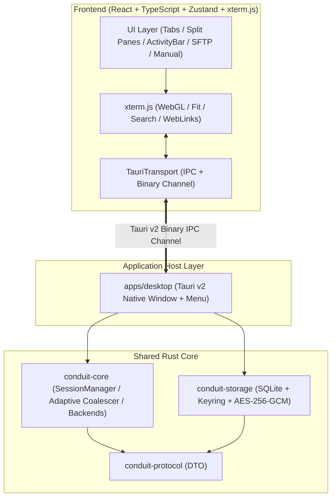

# Conduit — Multi-Protocol Desktop Terminal Emulator & Session Manager

Rust(`tokio` + `portable-pty` + `russh` + `russh-sftp` + `tokio-serial`) 기반의 고성능 코어 엔진과 **Tauri v2 데스크톱 앱(Windows/macOS/Linux)** 으로 구동되는 멀티 프로토콜 터미널 에뮬레이터 및 세션 매니저입니다.

---

## 주요 기능

- **멀티 프로토콜 세션 관리**
  - **Local PTY**: Windows PowerShell / CMD, macOS Zsh, Linux Bash 등 네이티브 PTY (`portable-pty`)
  - **SSH**: 비밀번호 및 개인키(Passphrase 지원) 인증, Keepalive, 포트 포워딩 인프라 (`russh`, `russh-keys`), 간편 SSH 연결(`Ctrl+Shift+E`)
  - **SFTP**: 동일 SSH 연결 위에서 멀티플렉싱되는 GUI 파일 탐색기 — 드래그 앤 드롭 업로드, 다운로드, 폴더 생성, 삭제 (`russh-sftp`)
  - **Serial**: 로컬 시리얼 포트 자동 열거 및 Baud rate / Parity 설정 접속 (`tokio-serial`)
  - **Telnet**: RFC 854 IAC 협상 및 NAWS 창 크기 동기화 지원 (`tokio::net`)
- **탭 & 최대 2×2 드래그 화면 분할(Split Pane) & 하단 Broadcast**
  - 멀티 탭, 패인/탭/북마크 드래그 자동 분할(최대 2×2), 드래그 리사이즈 스플리터
  - **하단 Broadcast 입력 (`Ctrl+Shift+M`)**: 전체 세션 / 현재 화면 세션 / 선택된 세션 3가지 모드로 Zero-Copy(`Bytes::clone`) 명령 전송
- **VS Code 스타일 Activity Bar & 중첩 폴더 트리 북마크**
  - 좌/우/하단 패널 토글 및 아이콘 드래그 패널 재배치, 리사이즈
  - SQLite 기반 다단계 폴더 트리 북마크(드래그 순서/폴더 이동, 삭제·종료 확인, JSON Import/Export), 앱 설정, SSH `known_hosts` (TOFU) 저장 (`rusqlite`)
  - OS 기본 키체인(`keyring`)에 256-bit 마스터 키 1개만 보관하고 각 자격 증명은 `AES-256-GCM`으로 암호화하는 **Envelope Encryption**
- **커스터마이징 & 내장 사용자 매뉴얼**
  - 5종 내장 컬러 스킴(Catppuccin Mocha, Tokyo Night, Dracula, One Dark Pro, Solarized Light)
  - Nerd Fonts 및 폰트 합자(Ligatures), 커서 스타일, 스크롤백, 세션 종료 확인 설정
  - **앱 내장 사용자 매뉴얼**: 상단 바 `매뉴얼 (F1)` 버튼 또는 네이티브 메뉴(`도움말 -> 사용자 매뉴얼`)로 언제든 확인 가능

---

## 시스템 아키텍처



---

## 디렉토리 구조

```text
conduit/
├── Cargo.toml                  # Cargo Workspace 루트
├── .github/workflows/          # CI 테스트/체크 및 OS별 포터블 릴리즈 빌드
├── scripts/                    # Tauri 데스크톱 아이콘 생성 스크립트
├── docs/                       # 아키텍처, 스트리밍, 보안, 사용자 매뉴얼 문서
├── crates/
│   ├── conduit-protocol/       # 공통 DTO, 세션/북마크/SFTP/설정 모델
│   ├── conduit-core/           # SessionManager, Adaptive Coalescer, PTY/SSH/SFTP/Serial/Telnet
│   └── conduit-storage/        # SQLite 북마크/설정/known_hosts + Keyring AES-256-GCM Vault
├── apps/
│   └── desktop/                # Tauri v2 데스크톱 앱 호스트 (네이티브 메뉴 포함)
└── frontend/                   # React + TypeScript + Zustand + xterm.js UI
```

---

## 기술 스택

| 계층 | 기술 | 역할 |
|---|---|---|
| Async Runtime | `tokio` | 비동기 세션, 네트워크, 채널 오케스트레이션 |
| Local PTY | `portable-pty` | 크로스 플랫폼 로컬 쉘 (전용 OS 스레드 격리) |
| SSH / SFTP | `russh`, `russh-keys`, `russh-sftp` | SSH 터미널 및 멀티플렉싱 SFTP 클라이언트 |
| Serial / Telnet | `tokio-serial`, `tokio::net` | 시리얼 포트 및 RFC 854 Telnet 접속 |
| Storage & Vault | `rusqlite`, `keyring`, `aes-gcm`, `zeroize` | SQLite 영속화 및 Envelope Encryption |
| Desktop Host | `Tauri v2` | 네이티브 윈도우, 메뉴, Binary IPC Channel |
| Frontend | `React`, `TypeScript`, `Zustand`, `xterm.js` | WebGL 터미널 렌더링, Split Pane, SFTP UI, 매뉴얼 |

---

## 빠른 시작 (Quick Start)

### 방법 1. 릴리즈 아카이브 다운로드 후 바로 실행 (권장)
GitHub [Releases](../../releases) 페이지에서 OS에 맞는 압축 파일을 받아 압축을 해제한 뒤 실행 파일을 바로 실행하면 됩니다.
- **Windows (`x86_64`)**: `.zip` 압축 해제 후 `conduit.exe` 실행
- **macOS (`arm64`)**: `.tar.gz` 또는 `.zip` 압축 해제 후 `Conduit Terminal.app` 실행 (최초 실행 시 Gatekeeper 경고가 뜨면 `xattr -cr "Conduit Terminal.app"` 실행)
- **Linux (`x86_64`)**: `.tar.gz` 압축 해제 후 `./conduit` 실행 (시스템에 `libwebkit2gtk-4.1` 필요)

### 방법 2. 소스에서 직접 빌드 및 실행

#### 사전 요구사항
- **Rust**: 1.80+ (`rustup`, `cargo`)
- **Node.js**: 22+ (`npm`)
- **OS별 Tauri v2 의존성**:
  - Windows: WebView2 Runtime, Visual Studio Build Tools (C++)
  - macOS: Xcode Command Line Tools
  - Linux: `libwebkit2gtk-4.1-dev`, `libayatana-appindicator3-dev`, `libsecret-1-dev`, `libudev-dev` 등

#### 1. 아이콘 및 프론트엔드 빌드

```bash
node scripts/generate-icons.mjs
cd frontend
npm install
npm run build
cd ..
```

#### 2. 데스크톱 앱 실행 (Tauri v2)

```bash
cargo run -p conduit-desktop
```

#### 3. 테스트 실행

```bash
cargo test --workspace
```

---

## 기본 단축키

| 단축키 | 동작 |
|---|---|
| `F1` | 내장 사용자 매뉴얼 열기 |
| `Ctrl + Tab` / `Ctrl + Shift + Tab` | 다음 / 이전 세션 탭 순환 이동 |
| `Ctrl + B` / `Ctrl + J` / `Ctrl + Alt + B` | 좌측 / 하단 / 우측 패널 토글 |
| `Ctrl + Shift + B` / `M` / `S` | 세션 북마크 / Broadcast / SFTP 뷰 토글 |
| `Ctrl + Shift + T` | 새 로컬 터미널 탭 열기 |
| `Ctrl + Shift + E` | 간편 SSH 연결 (`user@host`) |
| `Ctrl + Shift + D` | 현재 세션을 북마크에 저장 |
| `Ctrl + Shift + F` | 현재 터미널 검색 바 열기 |
| `Ctrl + ,` | 설정(테마 / 폰트 / 종료 확인) 열기 |

---

## 상세 설계 문서

- [01. 전체 시스템 아키텍처](docs/01-architecture.md)
- [02. 초저지연 스트리밍 및 백프레셔 데이터 흐름](docs/02-dataflow-and-streaming.md)
- [03. 데이터 저장소 및 Envelope Encryption 보안 설계](docs/03-storage-and-security.md)
- [04. Conduit 사용자 매뉴얼](docs/04-user-manual.md)

---

## 라이선스

[MIT License](LICENSE)
