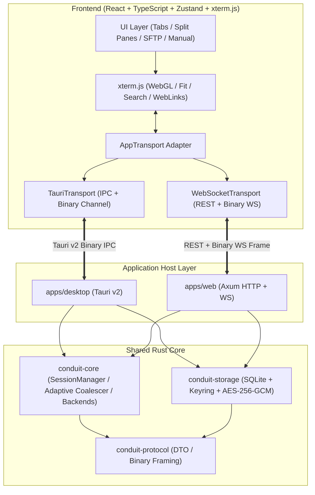

# Conduit — Hybrid Multi-Protocol Terminal Emulator & Session Manager

Rust(`tokio` + `portable-pty` + `russh` + `russh-sftp` + `tokio-serial`) 기반의 고성능 코어 엔진을 **Tauri v2 데스크톱 앱(Windows/macOS/Linux)** 과 **Axum 웹 서버(WebSocket)** 양쪽에서 그대로 재사용하는 하이브리드 터미널 에뮬레이터 및 세션 매니저입니다.

---

## 주요 기능

- **멀티 프로토콜 세션 관리**
  - **Local PTY**: Windows PowerShell / CMD, macOS Zsh, Linux Bash 등 네이티브 PTY (`portable-pty`)
  - **SSH**: 비밀번호 및 개인키(Passphrase 지원) 인증, Keepalive, 포트 포워딩 인프라 (`russh`, `russh-keys`)
  - **SFTP**: 동일 SSH 연결 위에서 멀티플렉싱되는 GUI 파일 탐색기 — 드래그 앤 드롭 업로드, 다운로드, 폴더 생성, 삭제 (`russh-sftp`)
  - **Serial**: 로컬 시리얼 포트 자동 열거 및 Baud rate / Parity 설정 접속 (`tokio-serial`)
  - **Telnet**: RFC 854 IAC 협상 및 NAWS 창 크기 동기화 지원 (`tokio::net`)
- **탭 & 재귀적 화면 분할(Split Pane) & Broadcast**
  - 멀티 탭, 수평/수직 무한 화면 분할, 드래그 리사이즈 스플리터
  - **Broadcast(동시 입력)**: 선택한 여러 세션에 입력 바이트를 Zero-Copy(`Bytes::clone`)로 동시 전송
- **폴더 트리 북마크 & OS 키체인 암호화 볼트**
  - SQLite 기반 계층형 폴더 트리 북마크(드래그 순서/폴더 이동, 삭제 확인, JSON Import/Export), 앱 설정, SSH `known_hosts` (TOFU) 저장 (`rusqlite`)
  - OS 기본 키체인(`keyring`)에 256-bit 마스터 키 1개만 보관하고 각 자격 증명은 `AES-256-GCM`으로 암호화하는 **Envelope Encryption**
  - 개인 로컬 서버/PC 구동을 기본으로 하여 웹 서버(`conduit-web`)의 접근 제어는 기본 비활성화(`access_control: false`, 추후 개발 예정)입니다.
- **커스터마이징 & 내장 사용자 매뉴얼**
  - 5종 내장 컬러 스킴(Catppuccin Mocha, Tokyo Night, Dracula, One Dark Pro, Solarized Light)
  - Nerd Fonts 및 폰트 합자(Ligatures), 커서 스타일, 스크롤백, 단축키 안내
  - **앱/웹 내장 사용자 매뉴얼**: 상단 바 `매뉴얼 (F1)` 버튼 또는 데스크톱 네이티브 메뉴(`도움말 -> 사용자 매뉴얼`)로 언제든 확인 가능

---

## 시스템 아키텍처



---

## 디렉토리 구조

```text
conduit/
├── Cargo.toml                  # Cargo Workspace 루트
├── docs/                       # 아키텍처, 스트리밍, 보안, 사용자 매뉴얼 문서
├── crates/
│   ├── conduit-protocol/       # 공통 DTO, 세션 설정, 5바이트 바이너리 프레이밍 규약
│   ├── conduit-core/           # SessionManager, Adaptive Coalescer, PTY/SSH/SFTP/Serial/Telnet
│   └── conduit-storage/        # SQLite 북마크/설정/known_hosts + Keyring AES-256-GCM Vault
├── apps/
│   ├── desktop/                # Tauri v2 데스크톱 앱 호스트 (네이티브 메뉴 포함)
│   └── web/                    # Axum 웹 서버 호스트 (REST + Binary WebSocket)
└── frontend/                   # React + TypeScript + Zustand + xterm.js 공용 UI
```

---

## 기술 스택

| 계층 | 기술 | 역할 |
|---|---|---|
| Async Runtime | `tokio` | 비동기 세션, 네트워크, 채널 오케스트레이션 |
| Local PTY | `portable-pty` | 크로스 플랫폼 로컬 쉘 (`spawn_blocking` 격리) |
| SSH / SFTP | `russh`, `russh-keys`, `russh-sftp` | SSH 터미널 및 멀티플렉싱 SFTP 클라이언트 |
| Serial / Telnet | `tokio-serial`, `tokio::net` | 시리얼 포트 및 RFC 854 Telnet 접속 |
| Storage & Vault | `rusqlite`, `keyring`, `aes-gcm`, `zeroize` | SQLite 영속화 및 Envelope Encryption |
| Desktop Host | `Tauri v2` | 네이티브 윈도우, 메뉴, Binary IPC Channel |
| Web Host | `Axum 0.8` | REST API, 정적 에셋 서빙, WebSocket 멀티플렉싱 |
| Frontend | `React`, `TypeScript`, `Zustand`, `xterm.js` | WebGL 터미널 렌더링, Split Pane, SFTP UI, 매뉴얼 |

---

## 빠른 시작 (Quick Start)

### 사전 요구사항
- **Rust**: 1.80+ (`rustup`, `cargo`)
- **Node.js**: 20+ (`npm`)
- **데스크톱 빌드 시 (Tauri v2)**:
  - Windows: WebView2 Runtime, Visual Studio Build Tools (C++)
  - macOS: Xcode Command Line Tools
  - Linux: `libwebkit2gtk-4.1-dev`, `libsecret-1-dev`, `libudev-dev` 등

### 1. 프론트엔드 빌드 (공통 필수)

```bash
cd frontend
npm install
npm run build
cd ..
```

### 2. 웹 서버 모드 실행 (Axum)

```bash
cargo run -p conduit-web
```
기본 주소 `http://127.0.0.1:3030` 으로 접속하면 브라우저에서 전체 기능을 바로 사용할 수 있습니다.
- 환경 변수 옵션:
  - `CONDUIT_BIND` (기본: `127.0.0.1:3030`)
  - `CONDUIT_DB` (기본: `./conduit.db`)
  - `CONDUIT_FRONTEND_DIR` (기본: `./frontend/dist`)

### 3. 데스크톱 앱 모드 실행 (Tauri v2)

```bash
# 개발 모드 (Vite HMR + Tauri)
cd frontend && npm run dev &
cargo run -p conduit-desktop

# 또는 빌드된 frontend/dist 기반 실행
cargo run -p conduit-desktop
```

### 4. 테스트 실행

```bash
cargo test --workspace
```

---

## 기본 단축키

| 단축키 | 동작 |
|---|---|
| `F1` | 내장 사용자 매뉴얼 열기 |
| `Ctrl + B` / `Ctrl + J` / `Ctrl + Alt + B` | 좌측 / 하단 / 우측 패널 토글 |
| `Ctrl + Shift + B` / `M` / `S` | 세션 북마크 / Broadcast / SFTP 뷰 토글 |
| `Ctrl + Shift + T` | 새 로컬 터미널 탭 열기 |
| `Ctrl + Shift + E` | 간편 SSH 연결 (`user@host`) |
| `Ctrl + Shift + D` | 현재 세션을 북마크에 저장 |
| `Ctrl + Shift + F` | 현재 터미널 검색 바 열기 |
| `Ctrl + ,` | 설정(테마 / 폰트 / 종료 확인) 열기 |

---

## 상세 설계 문서

- [01. 전체 시스템 아키텍처](docs/01-architecture.md)
- [02. 초저지연 스트리밍 및 백프레셔 데이터 흐름](docs/02-dataflow-and-streaming.md)
- [03. 데이터 저장소 및 Envelope Encryption 보안 설계](docs/03-storage-and-security.md)
- [04. Conduit 사용자 매뉴얼](docs/04-user-manual.md)

---

## 라이선스

[MIT License](LICENSE)
