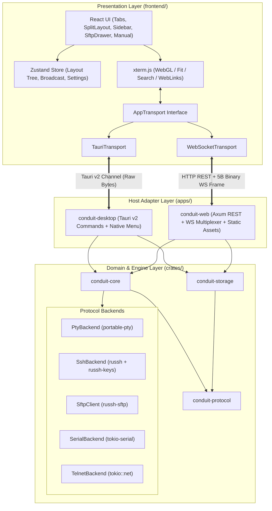

# 01. 전체 시스템 아키텍처 설계서

## 1. 설계 목표

Conduit은 **단일 Rust 코어 엔진(`conduit-core`)** 과 **단일 React/TypeScript 프론트엔드(`frontend`)** 를 공유하면서 다음 두 가지 배포 형태를 모두 1급 시민(First-class)으로 지원합니다.

1. **Desktop Native App (`apps/desktop`)**: Tauri v2 기반의 경량 데스크톱 앱 (Windows, macOS, Linux). 네이티브 메뉴 바, OS 키체인 통합, Zero-JSON Binary IPC 채널을 제공합니다.
2. **Web Server Mode (`apps/web`)**: Axum HTTP + WebSocket 서버로 동작하며, 원격 서버나 로컬 컨테이너에 띄워 브라우저로 접속하는 웹 터미널/세션 매니저입니다.

---

## 2. 레이어드 하이브리드 아키텍처



---

## 3. Cargo Workspace 크레이트 책임 분리

| 크레이트 | 역할 | 주요 의존성 |
|---|---|---|
| `conduit-protocol` | 전 계층 공용 DTO(`SessionConfig`, `Bookmark`, `AppSettings`, `SftpEntry`) 및 WebSocket 바이너리 프레임 인코더/디코더 | `serde`, `bytes` |
| `conduit-core` | `SessionManager`, `SessionBackend` 트레이트, `Adaptive Coalescer` & `FlowController`, 5종 프로토콜 백엔드 구현 | `tokio`, `portable-pty`, `russh`, `russh-sftp`, `tokio-serial`, `dashmap` |
| `conduit-storage` | SQLite 기반 폴더/북마크/설정/`known_hosts` 저장소 및 OS Keyring + AES-256-GCM 보안 볼트 | `rusqlite`, `keyring`, `aes-gcm`, `zeroize` |
| `conduit-desktop` | Tauri v2 윈도우, 네이티브 메뉴(`도움말 -> 사용자 매뉴얼`), Tauri IPC 커맨드 및 Binary Channel 바인딩 | `tauri`, `conduit-core`, `conduit-storage` |
| `conduit-web` | Axum REST API, 단일 소켓 다중 세션 WebSocket 멀티플렉서, 빌드된 `frontend/dist` 정적 파일 서빙 | `axum`, `tower-http`, `conduit-core`, `conduit-storage` |

---

## 4. 프론트엔드 전송 추상화 (`AppTransport`)

프론트엔드 컴포넌트(`TerminalPane`, `Sidebar`, `SftpDrawer`, `SettingsModal`)는 자신이 Tauri 내부에서 실행 중인지 일반 웹 브라우저에서 실행 중인지 알 필요가 없습니다.

- `createTransport()` 팩토리가 런타임에 `'__TAURI_INTERNALS__' in window` 여부를 검사합니다.
- **Desktop 환경**: `TauriTransport`가 선택되며, `Channel<InvokeResponseBody>`를 통해 Rust에서 보낸 Raw `Uint8Array`를 직접 수신합니다.
- **Web 환경**: `WebSocketTransport`가 선택되며, 단일 WebSocket 연결에서 `session_id` 기반 5바이트 바이너리 프레임으로 다중 세션을 멀티플렉싱하고 북마크/설정/SFTP는 `/api/*` REST 엔드포인트를 사용합니다.

---

## 5. 확장성 및 재귀적 화면 분할 모델

Zustand 스토어는 각 탭의 레이아웃을 **재귀적 이진 트리(`SplitNode`)** 로 관리합니다.

```text
SplitNode =
  | { type: "pane"; id: string; sessionId: number | null; title: string; config: SessionConfig }
  | { type: "split"; id: string; direction: "horizontal" | "vertical"; ratio: number; first: SplitNode; second: SplitNode }
```

이 구조 덕분에 수평/수직 분할을 깊이 제한 없이 조합할 수 있으며, 특정 패인을 닫을 때 형제 노드가 자연스럽게 부모 자리를 승계합니다.
