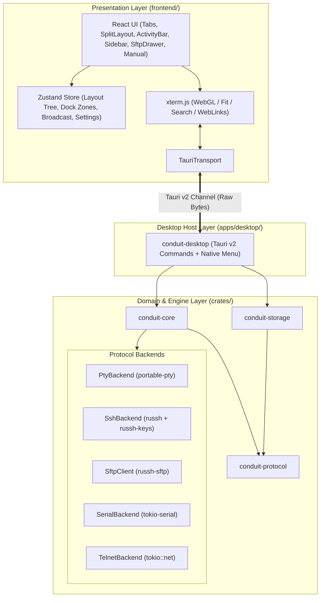

# 01. 전체 시스템 아키텍처 설계서

## 1. 설계 목표

Conduit은 **단일 Rust 코어 엔진(`conduit-core`)** 과 **React/TypeScript 프론트엔드(`frontend`)** 를 결합한 **Tauri v2 네이티브 데스크톱 터미널 에뮬레이터(Windows, macOS, Linux)** 입니다. 네이티브 메뉴 바, OS 키체인 통합, Zero-JSON Binary IPC 채널을 기본 제공합니다.

---

## 2. 레이어드 데스크톱 아키텍처



---

## 3. Cargo Workspace 크레이트 책임 분리

| 크레이트 | 역할 | 주요 의존성 |
|---|---|---|
| `conduit-protocol` | 전 계층 공용 DTO(`SessionConfig`, `Bookmark`, `AppSettings`, `SftpEntry`) | `serde` |
| `conduit-core` | `SessionManager`, `SessionBackend` 트레이트, `Adaptive Coalescer` & `FlowController`, 5종 프로토콜 백엔드 구현 | `tokio`, `portable-pty`, `russh`, `russh-sftp`, `tokio-serial`, `dashmap` |
| `conduit-storage` | SQLite 기반 폴더/북마크/설정/`known_hosts` 저장소 및 OS Keyring + AES-256-GCM 보안 볼트 | `rusqlite`, `keyring`, `aes-gcm`, `zeroize` |
| `conduit-desktop` | Tauri v2 윈도우, 네이티브 메뉴(`보기`, `도움말 -> 사용자 매뉴얼`), Tauri IPC 커맨드 및 Binary Channel 바인딩 | `tauri`, `conduit-core`, `conduit-storage` |

---

## 4. 프론트엔드 전송 추상화 (`AppTransport`)

프론트엔드 UI 컴포넌트(`TerminalPane`, `Sidebar`, `SftpDrawer`, `SettingsModal`)는 `TauriTransport` 구현을 통해 Rust 백엔드와 통신합니다.

- `getTransport()`가 `TauriTransport` 싱글톤을 반환합니다.
- 터미널 출력 스트림은 `tauri::ipc::Channel<InvokeResponseBody>`를 통해 JSON/Base64 직렬화 없이 Raw `Uint8Array`로 전달됩니다.
- 네이티브 메뉴 바(`보기` / `도움말`) 이벤트는 Tauri 이벤트를 통해 프론트엔드 액션과 동기화됩니다.

---

## 5. 확장성 및 재귀적 화면 분할 모델

Zustand 스토어는 각 탭의 레이아웃을 **재귀적 이진 트리(`SplitNode`)** 로 관리합니다.

```text
SplitNode =
  | { type: "pane"; id: string; sessionId: number | null; title: string; config: SessionConfig }
  | { type: "split"; id: string; direction: "horizontal" | "vertical"; ratio: number; first: SplitNode; second: SplitNode }
```

드래그 자동 분할은 가독성을 위해 한 탭당 최대 **2×2(4개 패인)** 로 제한되며, 특정 패인을 닫을 때 형제 노드가 자연스럽게 부모 자리를 승계합니다.
