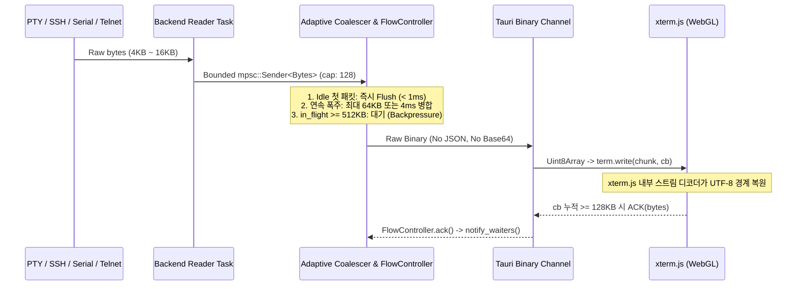

# 02. 초저지연 스트리밍 및 백프레셔 데이터 흐름 설계

## 1. 터미널 I/O의 핵심 난제

터미널 에뮬레이터는 서로 상충하는 두 가지 성능을 동시에 만족해야 합니다.

1. **초저지연 대화형 입력(Interactive Echo)**: 사용자가 키를 누른 후 1~2ms 이내에 화면에 반영되어야 합니다.
2. **대량 출력 폭주 제어(Throughput Flood Control)**: `cat huge.log`, `find /`, 대규모 컴파일 로그처럼 초당 수십 MB가 쏟아질 때도 WebView 메인 스레드가 멈추지 않고 `Ctrl+C` 인터럽트가 즉시 동작해야 합니다.

---

## 2. End-to-End 데이터 파이프라인

---

## 3. 5가지 핵심 최적화 기법

### 3.1 블로킹 PTY I/O와 Tokio 런타임 격리
`portable-pty`의 `Read`/`Write`는 OS 파이프에 대한 동기 블로킹 호출입니다. 이를 `tokio` 비동기 워커나 `spawn_blocking` 풀에 묶어두면 다른 비동기 세션이나 Tokio 런타임 종료(`drop`) 시 블로킹 스레드 대기로 멈춤이 발생할 수 있습니다.
- **해결**: `PtyBackend::spawn()`은 Reader와 Writer 각각을 전용 OS 스레드(`std::thread::Builder`)에 격리하고, 경량 `bytes::Bytes` 채널(`mpsc`)로 비동기 파이프라인과 연결하며, `ChildKiller`를 보유해 세션 종료/`Drop` 시 자식 쉘 프로세스를 즉시 정리합니다.
- Unix 계열에서는 `pair.slave` 핸들을 `spawn_command` 직후 즉시 `drop(pair.slave)` 하여 자식 프로세스 종료 시 Reader가 즉시 EOF를 받도록 보장합니다.

### 3.2 적응형 출력 병합 (Adaptive Output Coalescing)
고정 주기(예: 16ms) 배치 전송은 타이핑할 때마다 최대 16ms의 체감 지연을 유발합니다.
- **Idle 상태 (직전 전송 후 4ms 이상 경과)**: 첫 번째 청크가 도착하면 큐에 이미 들어온 청크만 논블로킹(`try_recv`)으로 흡수한 뒤 **즉시 전송**합니다.
- **Burst 상태 (4ms 이내 후속 청크 연속 도착)**: `MAX_BATCH_BYTES (64KB)` 또는 `COALESCE_WINDOW (4ms)` 한도까지 `BytesMut`에 병합해 IPC 프레임 오버헤드와 `xterm.js` 파싱 호출 빈도를 대폭 감소시킵니다.

### 3.3 Watermark 기반 백프레셔 (Flow Control)
생산자(Rust 백엔드)가 소비자(`xterm.js`)보다 빠를 때 메모리 폭증과 UI 프리징을 막기 위한 흐름 제어입니다.
- `FlowController`가 미확인 전송 바이트 수(`in_flight`)를 원자적으로 추적합니다.
- `in_flight >= HIGH_WATERMARK (512KB)`에 도달하면 출력 펌프가 `Notify::notified().await`로 대기하며, 이로 인해 Bounded `mpsc`가 채워져 OS PTY 파이프 및 SSH TCP 윈도우까지 자연스럽게 백프레셔가 전파됩니다.
- 프론트엔드는 `term.write(chunk, callback)`의 `callback`이 실행된 누적 바이트가 `LOW_WATERMARK (128KB)`에 도달할 때마다 `ack(bytes)`를 전송해 파이프라인을 재개합니다.

### 3.4 입력/제어 채널 완전 분리 (`Ctrl+C` 우선순위 보장)
출력 채널이 백프레셔로 멈춘 상황에서도 사용자의 `Ctrl+C`(`0x03`)나 화면 리사이즈는 즉시 전달되어야 합니다.
- `PtyBackend`: 별도의 `input_tx`와 Writer 스레드로 분리.
- `SshBackend`: `tokio::select! { biased; ... }` 구문에서 `ctrl_rx`(Write/Resize/Close) 브랜치를 `channel.wait()` 브랜치보다 항상 먼저 검사합니다.

### 3.5 Zero-JSON / Zero-Base64 바이너리 전송 & UTF-8 안전성
- **Tauri v2**: `tauri::ipc::Channel<InvokeResponseBody>`에 `InvokeResponseBody::Raw(Vec<u8>)`를 전달하여 JSON/Base64 직렬화를 완전히 생략합니다.
- **UTF-8 멀티바이트 경계 보호**: Rust에서 `String::from_utf8_lossy`로 변환하면 청크 경계에서 3바이트 한글이나 4바이트 이모지가 손상됩니다. 반드시 Raw `Uint8Array` 그대로 `xterm.write(chunk)`에 넘겨 `xterm.js` 내장 스트림 UTF-8 디코더가 처리하게 합니다.
- **Broadcast Zero-Copy Fan-out**: `SessionManager::broadcast()`는 입력 `Bytes`를 복제하지 않고 `Bytes::clone()`(참조 카운트 증가)만으로 대상 세션들에 동시 전달합니다.
